# Roadmap y TODO List — Zero (Auditoría Visual de 28 Puntos)

Documento estructurado a partir del registro visual y notas del equipo. Cada punto incluye su captura original, el problema identificado y la solución técnica a implementar en el DataModel de Roblox Studio.

---

## Módulo 1: Jugabilidad y Mecánicas de Ronda

### 1.1 Stalker: Ataque bloqueado durante invisibilidad y cancelación manual [RESUELTO]
- **Problema**: El Stalker puede atacar mientras está invisible, o se queda trabado sin poder cancelar su habilidad anticipadamente.
- **Acción**: Desactivar el ataque mientras la habilidad esté activa; presionar de nuevo la tecla de habilidad (`F`) desactiva el sigilo de inmediato y rehabilita el combate.
- **Implementación**:
  - `HunterClassService`: Sincronización del atributo replicado `StalkerStealth`. Cancelación manual anticipada al presionar `F` mientras la habilidad está activa, recalculando cooldown restante con feedback reactivo.
  - `CombatService`: Validación autoritativa en el servidor para rechazar ataques si `StalkerStealth == true`.
  - `HunterKnifeClient` y `ZeroMovement`: Supresión inmediata de peticiones de ataque y animaciones locales durante sigilo.
  - `HunterAbilityController` y `ZeroUIClient`: Bypass de cooldown local al pulsar `F` en sigilo para permitir cancelación manual; renderizado reactivo del botón HUD a `F • CANCELAR`.
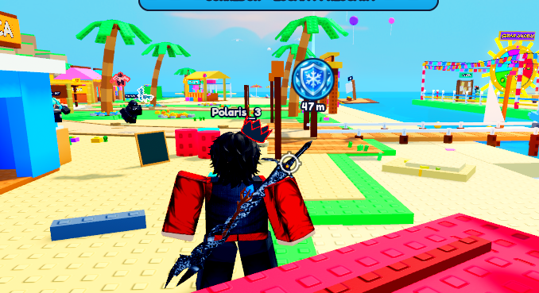

### 1.2 Feedback de impacto en bolas de nieve
- **Problema**: El ataque a distancia / bola de nieve carece de indicador claro de impacto.
- **Acción**: Añadir VFX de explosión de nieve y SFX audible con radio de atenuación 3D en el punto de contacto.

### 1.3 Pose rígida / glitch de animación al congelar
- **Problema**: Al congelarse un corredor, el resto de los jugadores lo ven completamente rígido ("tieso") aunque localmente él sí vea sus animaciones.
- **Acción**: Ajustar la replicación de estados en `PlayerStateService` y detener formalmente los AnimationTracks replicados para todos los clientes sin desincronizar el ensamble.
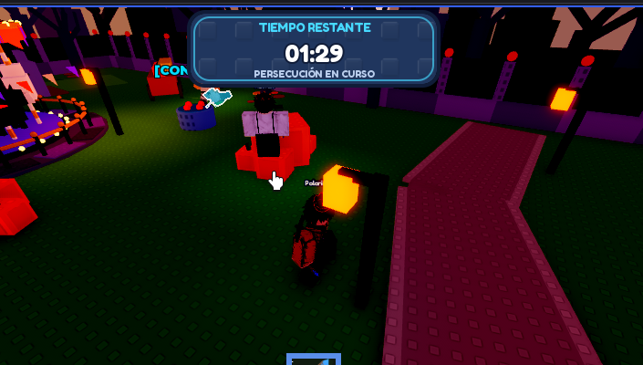

### 1.4 Limpieza del icono y efecto de Escudo al terminar ronda
- **Problema**: El icono flotante del escudo persiste en pantalla tras terminar la partida.
- **Acción**: Añadir evento de limpieza forzada en cliente y servidor al cambiar el estado a `ROUND_END` y `LOBBY`.
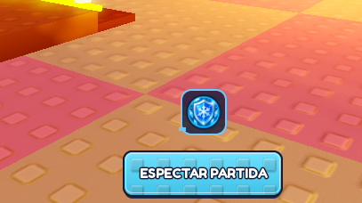

### 1.5 Pausa de celebración y resultado al finalizar ("Ganó X")
- **Problema**: El juego termina bruscamente sin dar tiempo a digerir la victoria del Cazador o de los Corredores.
- **Acción**: Introducir pantalla de clímax de 4 a 5 segundos con banner de victoria, cámara cinematográfica y SFX conmemorativo antes del teletransporte al Lobby.

### 1.6 Power-up de velocidad (+35%): Exceso de impulso y expulsión física ("salir volando")
- **Problema**: Al recoger el boost de velocidad (+35%) en el mapa, la física colapsa y lanza al jugador por los aires.
- **Acción**: Limitar `Humanoid.WalkSpeed` de forma controlada sin alterar `AssemblyLinearVelocity` vertical (Y = 0) y revisar la fricción en `ZeroMovement` para evitar despegue en rampas.

---

## Módulo 2: Lobby, Inmersión e Interacción

### 2.1 Preservar a jugadores que están en el Lobby al finalizar ronda
- **Problema**: Al terminar la ronda, el servidor teletransporta indiscriminadamente a todos los jugadores, interrumpiendo a quienes ya estaban en el lobby.
- **Acción**: Filtrar por rol (`Active` vs `Lobby`); solo reubicar a quienes participaron en el mapa.

### 2.2 Sillas interactivas / sentables en Lobby
- **Problema**: Los bancos y sillas del Lobby son bloques estáticos sin `Seat`.
- **Acción**: Reemplazar la base con instancias `Seat` calibradas para sentarse automáticamente al interactuar.
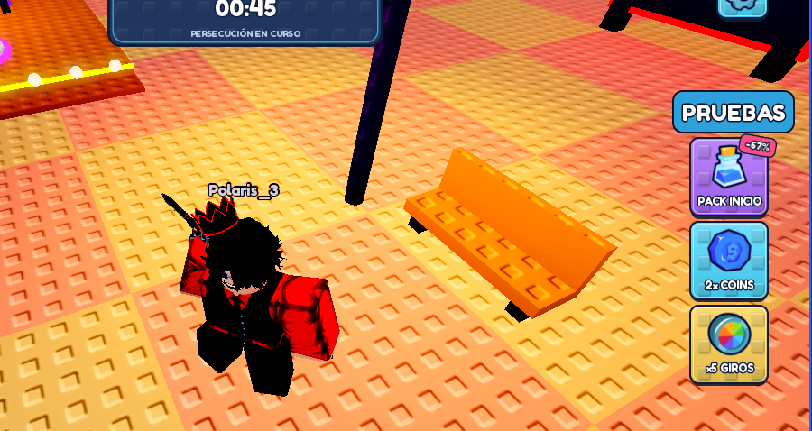

### 2.3 Ocultar etiqueta de nombre en primera persona
- **Problema**: Al pasar a primera persona, el nombre del propio jugador flota frente a la cámara obstruyendo la visión.
- **Acción**: Escuchar `Camera.CameraSubject` o distancia de zoom para ocultar el BillboardGui local del usuario.
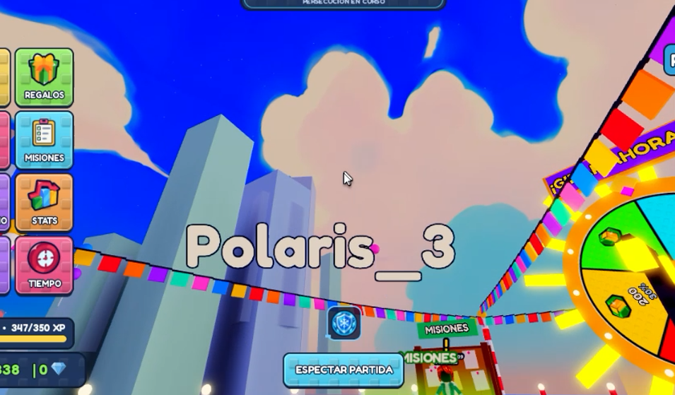

### 2.4 Detección e indicador visual de jugadores AFK
- **Problema**: Jugadores ausentes bloquean votaciones de mapa y partidas sin aviso.
- **Acción**: Sistema de inactividad que inhabilite el voto y despliegue un badge "AFK" suave y pulsante sobre el personaje.

### 2.5 Atenuación espacial 3D para popups "PERFECT" y SFX
- **Problema**: Notificaciones y efectos de sonido se reproducen globalmente para todos sin importar la distancia.
- **Acción**: Limitar los popups visuales al jugador implicado o a un radio visual cercano; usar `Sound.RollOffMaxDistance` y posición en mundo para el audio.

---

## Módulo 3: Tienda, Pases y Monetización

### 3.1 Prompts de compra con Robux en tarjetas y pedestales
- **Problema**: Los botones de compra en tienda y en pedestales físicos no disparan `MarketplaceService:PromptGamePassPurchase` ni `PromptProductPurchase`.
- **Acción**: Vincular cada botón con su respectivo ProductID / PassID oficial.
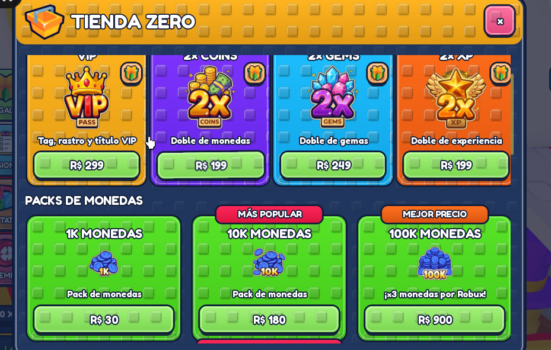
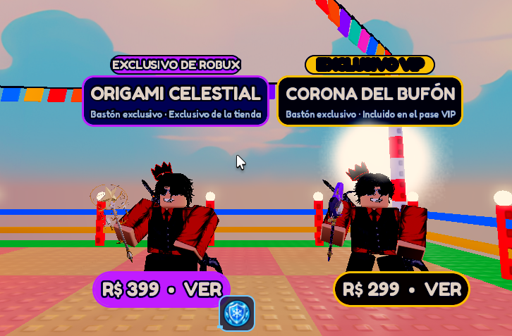

### 3.2 Corrección de recorte visual (Clipping) en Tienda y Caja Legendaria
- **Problema**: El panel lateral derecho y la cuarta caja (Caja Legendaria) se encuentran cortados fuera del marco.
- **Acción**: Ajustar `CanvasSize`, padding y `UIGridLayout`/`UIListLayout` con escala relativa (`Scale` en lugar de `Offset` absoluto fijo).
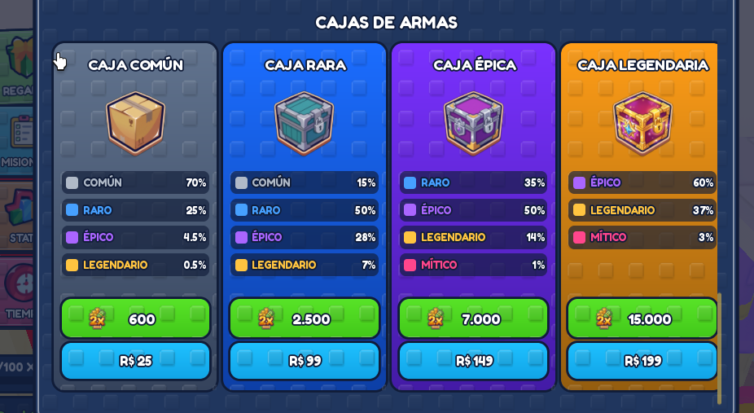
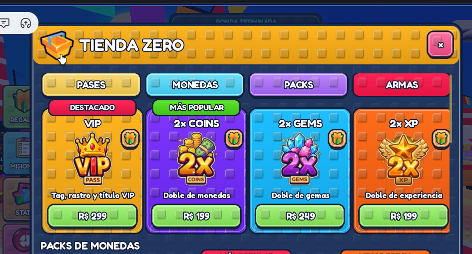

### 3.3 Re-apertura accesible de tienda sin obligar a reingresar a la zona
- **Problema**: Si el jugador cierra la tienda, debe salir físicamente del área y volver a entrar para activarla.
- **Acción**: Colocar un `ProximityPrompt` persistente ("Abrir Tienda") en el mostrador del NPC + botón de acceso rápido en HUD.

### 3.4 Modal de Regalar Pase: Botón Volver y cierre seguro
- **Problema**: Al presionar la 'X' en la ventana de regalar se cierra toda la tienda en vez de regresar a la lista de pases.
- **Acción**: Añadir botón de flecha atrás ("Volver") y hacer que la 'X' solo cierre el sub-modal de regalos.
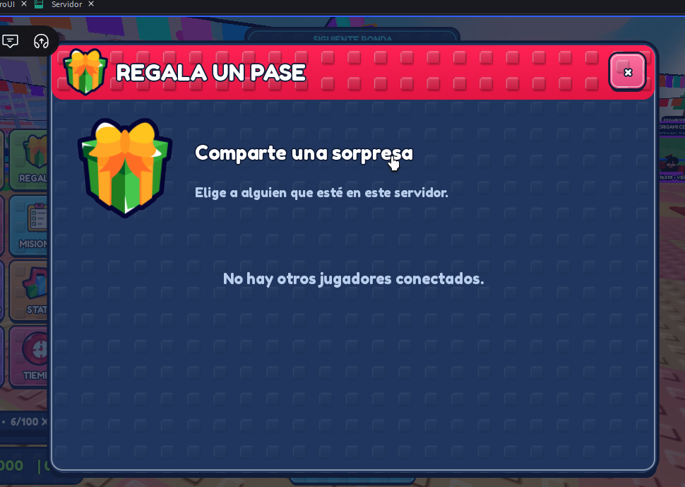

### 3.5 Efecto visual de brillo/rayos (Sunburst) en iconos de cajas
- **Problema**: Las cajas lucen planas sin dinamismo.
- **Acción**: Añadir capa de fondo rotatoria con rayos de luz alternados ("Sunburst") detrás de cada cofre.
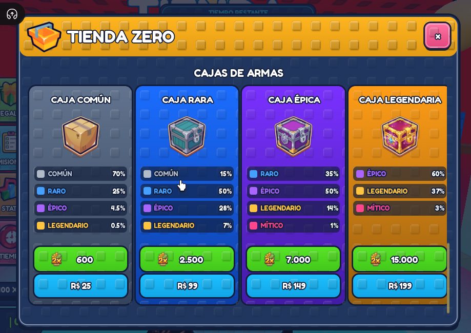

---

## Módulo 4: Ruleta de la Fortuna

### 4.1 Z-Index del banner de premio ganado
- **Problema**: El texto y recuadro del premio obtenido ("+200 MONEDAS", etc.) se renderizan por detrás del disco de la ruleta.
- **Acción**: Subir el `ZIndex` del contenedor de resultado por encima de la capa de la rueda.
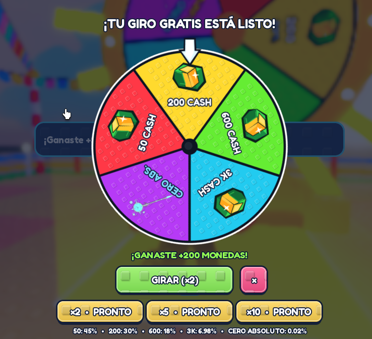

### 4.2 Compra de giros con Robux y cumplimiento de normativas de país
- **Problema**: Cuando los giros llegan a 0 (`GIRAR (x0)`), falta el prompt de compra con Robux y la validación legal de compras aleatorias.
- **Acción**: Integrar `PolicyService:GetPolicyInfoForPlayerAsync` (`ArePaidRandomItemsRestricted`). Si está restringido por país, ocultar o inhabilitar la compra con Robux para giros de ruleta.
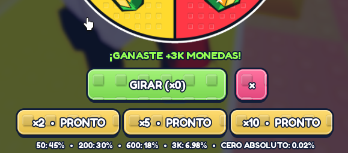

---

## Módulo 5: Inventario y Armas

### 5.1 Ordenamiento ascendente por rareza
- **Problema**: Las armas aparecen sin jerarquía clara (míticas mezcladas arriba).
- **Acción**: Ordenar la lista: Común → Raro → Épico → Legendario → Mítico → Exclusivo.
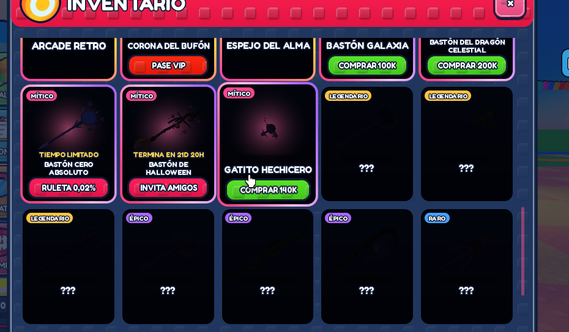

### 5.2 Inspección 3D / "Ver más" sin cerrar el menú
- **Problema**: Al hacer clic en un arma para verla, todo el menú de inventario se cierra automáticamente. Además los ViewportFrames son demasiado pequeños.
- **Acción**: Al hacer clic, abrir modal de detalle/inspección ampliado ("Ver más") con rotación 3D del bastón y botón para alternar entre vista sola y personaje sosteniéndolo, sin cerrar el inventario.
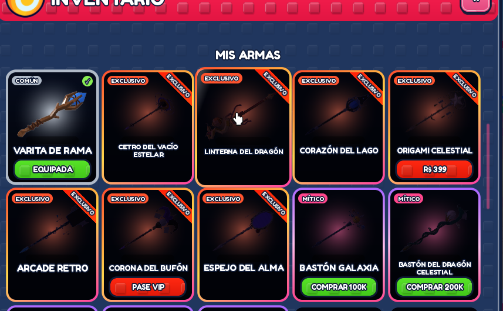
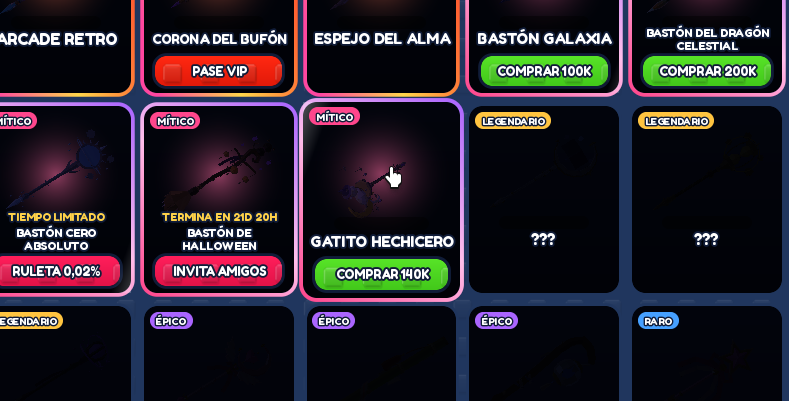

### 5.3 Corrección de equipamiento tras compra
- **Problema**: Al comprar un arma exclusiva/mítica, no se equipa y sale el mensaje de que ya se posee sin permitir seleccionarla.
- **Acción**: Actualizar el estado en `DataService` al completar la transacción y refrescar inmediatamente el botón de la tarjeta a "EQUIPAR" / "EQUIPADA".
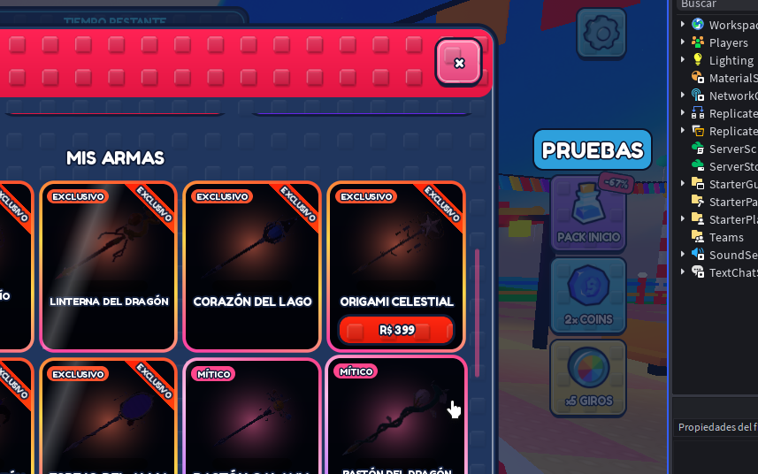

### 5.4 Optimización de rendimiento móvil para ViewportFrames
- **Problema**: Renderizar decenas de ViewportFrames 3D simultáneos causa caídas de frames en dispositivos móviles.
- **Acción**: Renderizado bajo demanda (solo las celdas visibles) o uso de thumbnails estáticos optimizados en móvil, activando la vista 3D completa únicamente en el modal de inspección.

---

## Módulo 6: Interfaz General, HUD y Modales

### 6.1 Corrección de interacción del cursor en ProximityPrompts
- **Problema**: Con Shift-Lock activado, el cursor del mouse interfiere visualmente o se desfasa sobre el prompt de rescate.
- **Acción**: Forzar alineación y comportamiento del mouse en modo rescate.
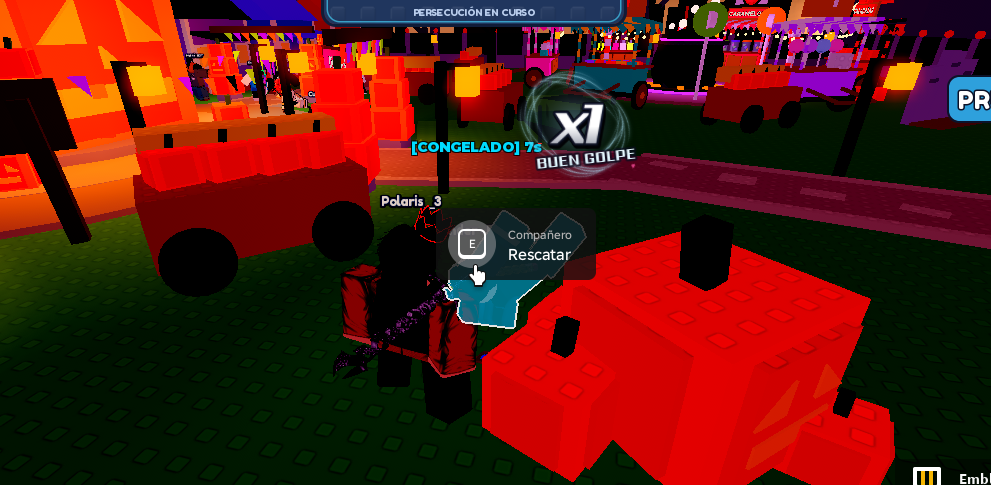

### 6.2 Eliminación de selectores redundantes e innecesarios
- **Problema**: Hay dos menús redundantes:
  1. El sub-menú de habilidades secundarias ("Pulso / Embestida / Trampa") que ya no aplica.
  2. El modal "PARTIDA EN CURSO" con opciones ambiguas antes de espectar.
- **Acción**: Eliminar ambos menús. El botón "ESPECTAR PARTIDA" debe llevar directo al modo espectador con la barra moderna.
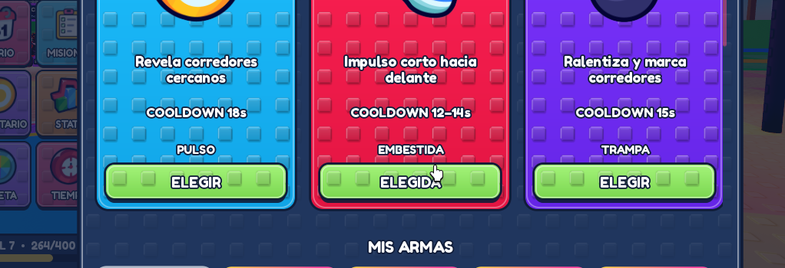
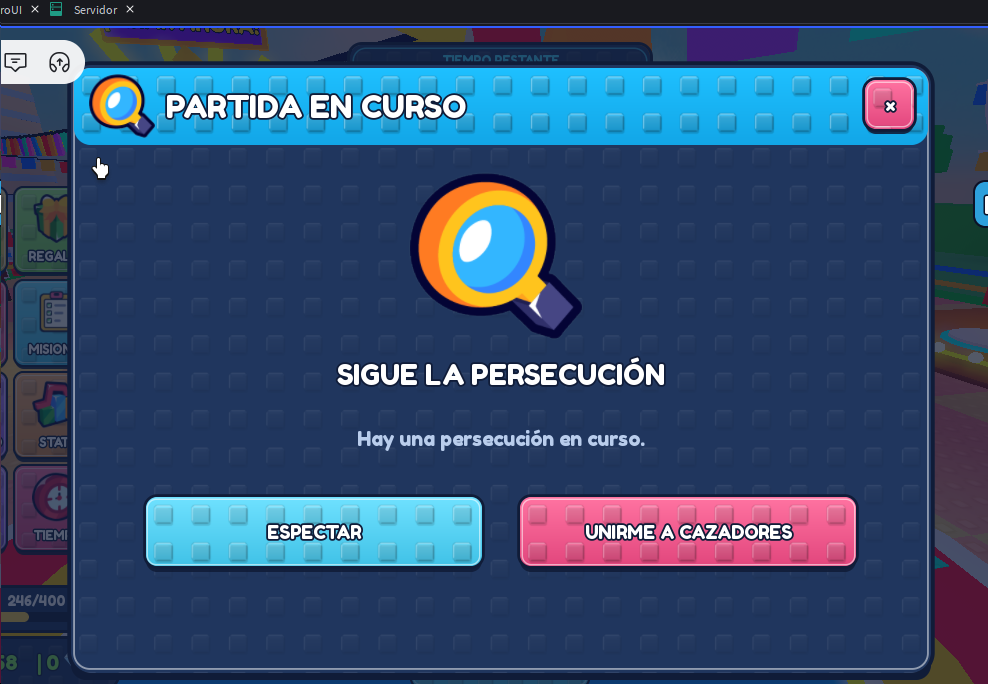

### 6.3 Modernización de la barra de espectador (Reemplazo de barra legacy)
- **Problema**: La barra inferior de espectador (`< JUGADOR > SALIR`) mantiene un diseño anticuado desalineado con `ZeroUI`.
- **Acción**: Reconstruirla con el diseño moderno de bordes redondeados y tipografía oficial del proyecto.
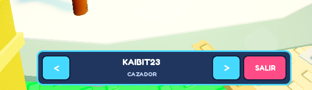

### 6.4 Correcciones en Misiones (Scrollbar fantasma y centrado)
- **Problema**: Hay una barra de scroll café innecesaria y el botón "RECLAMAR" tiene desvío visual a la derecha. La confirmación del servidor tarda en reflejarse.
- **Acción**: Desactivar `ScrollBarVisible`, centrar el ancla del botón `Reclamar` y añadir estado de carga optimista en cliente.
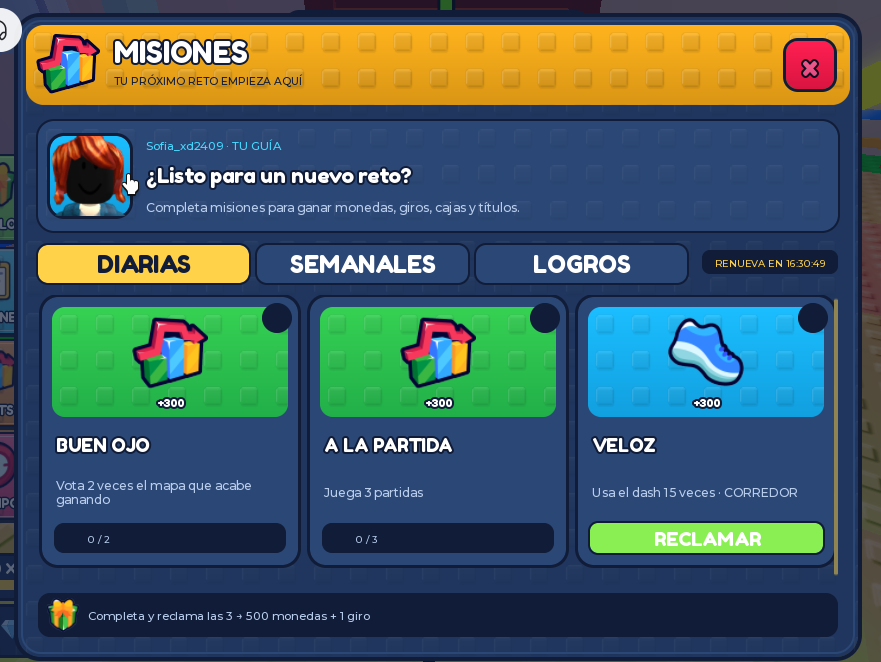

### 6.5 Animaciones Pop-In con EaseOut y rotación en apertura de menús
- **Problema**: Los menús aparecen de golpe sin transición suave.
- **Acción**: Añadir tween general con `Enum.EasingStyle.Back` o `Quad` (EaseOut) y escala/rotación sutil al abrir cualquier panel de `ZonasMenu` o inventario.
